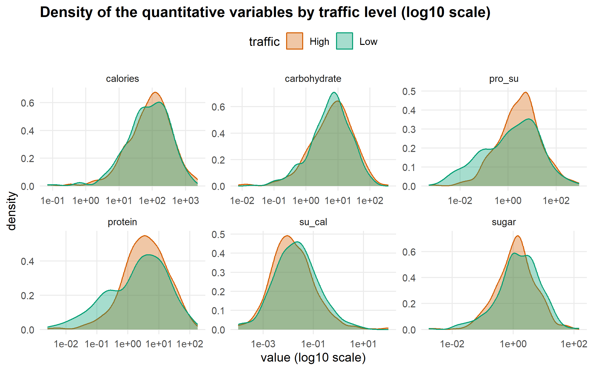
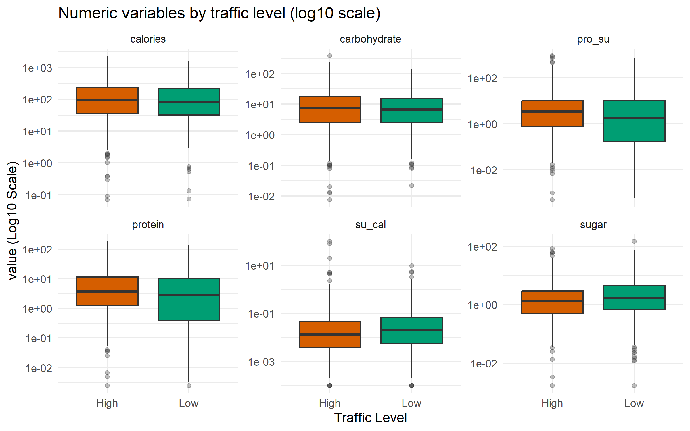
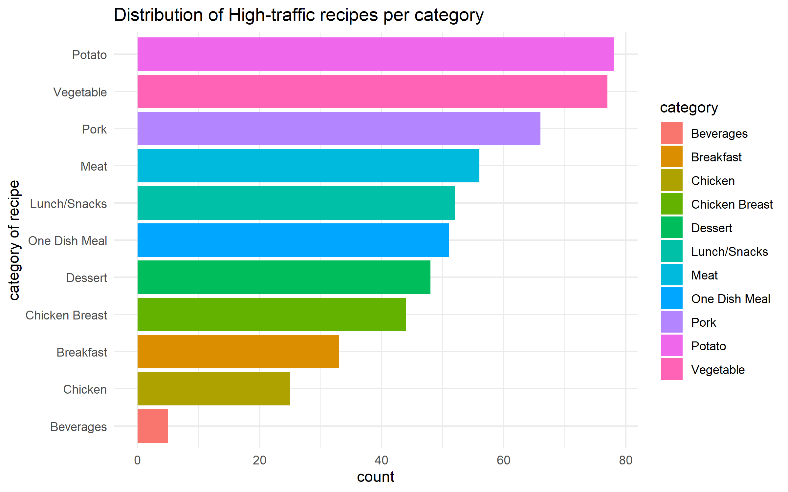
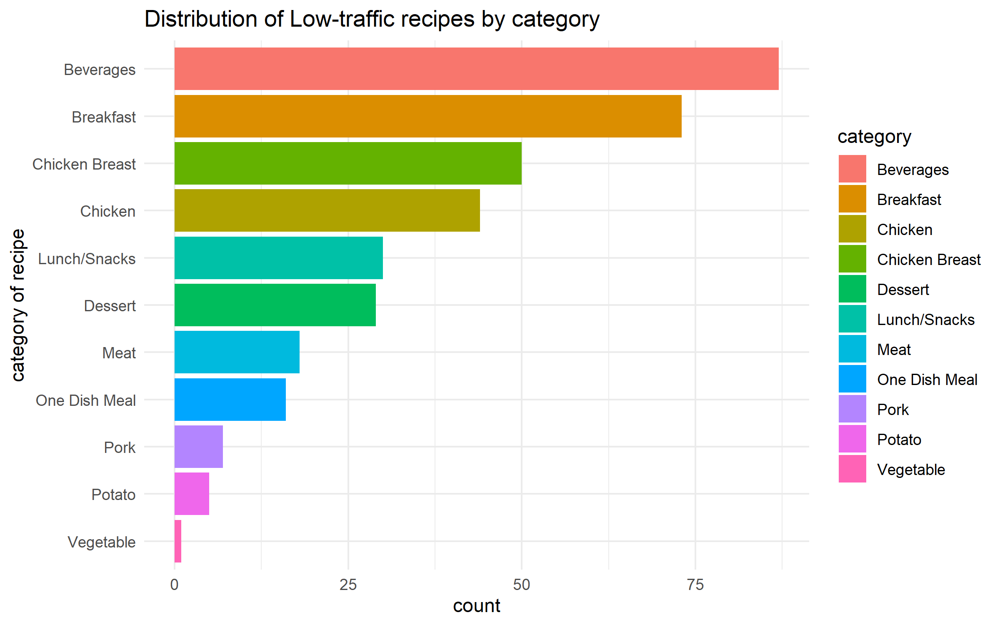

# Predicting High-Traffic Recipes: A Binary Classification Study


A reproducible R Markdown project that predicts whether a recipe published on a cooking website generates **High** or **Low** traffic, from its category, number of servings and nutritional content. Four models are compared (linear probability model, logit, LASSO and random forest), and the selected model is used to identify **which recipe characteristics drive traffic**.

---

## Table of contents

- [Context and objectives](#context-and-objectives)
- [Dataset](#dataset)
- [Methodology](#methodology)
- [Key findings](#key-findings)
- [Repository structure](#repository-structure)
- [Getting started](#getting-started)
- [Reproducibility](#reproducibility)
- [Limitations and next steps](#limitations-and-next-steps)

---

## Context and objectives

A recipe website wants to know which recipes attract the most visitors, in order to decide which ones to feature on its home page. The project answers three questions:

1. **Prediction**: can we predict, from a recipe's characteristics, whether it will generate high traffic?
2. **Drivers**: which variables (category, servings, nutrition) are the main determinants of traffic?
3. **Action**: what can the site do, based on these insights, to increase traffic?

## Dataset

File: [`recipe_site_traffic_2212.csv`](recipe_site_traffic_2212.csv), 947 recipes and 8 variables.

| Variable | Type | Description |
|---|---|---|
| `recipe` | identifier | Unique recipe ID (removed before modelling) |
| `calories` | numeric | Calories of the recipe |
| `carbohydrate` | numeric | Carbohydrates (g) |
| `sugar` | numeric | Sugar (g) |
| `protein` | numeric | Protein (g) |
| `category` | categorical | Recipe category (11 levels, e.g. Vegetable, Potato, Pork, Beverages) |
| `servings` | categorical | Number of servings (1, 2, 4 or 6) |
| `high_traffic` | target | `"High"` when traffic was high, missing otherwise |

## Methodology

The analysis follows seven steps, numbered as in the report.

1. **Data wrangling**
   - Quality checks: unique identifiers, duplicates, missing values.
   - Missing `high_traffic` values are interpreted as **Low**, which is an assumption discussed in the limitations.
   - Rows with missing nutritional values (about 5%) are removed after checking that they are spread over categories and classes. 895 observations remain.
   - Feature engineering: nutrition **per serving**, plus two ratios, `su_cal` (sugar / calories) and `pro_su` (protein / sugar).
2. **Exploratory data analysis**
   - Target distribution and naive benchmark (always predicting "High").
   - Share of High traffic by category.
   - Histograms, **density plots by traffic class**, boxplots on a log scale.
   
   
   
 

   - **Comparison of means** between classes (Welch t-test and Wilcoxon test with Holm correction), plus chi-squared tests for the discrete variables.
   - Correlation matrix.
3. **Data splitting**: stratified 70% / 30% train / test split (`seed = 123`).
4. **Estimation**
   - Linear probability model (with heteroskedasticity-robust standard errors).
   - Logit (odds ratios, McFadden pseudo-R², likelihood-ratio test, VIF, marginal effects).
   - **LASSO** penalised logit, with λ chosen by 10-fold cross-validation on the AUC.
5. **Random forest**: `mtry` tuned by 10-fold cross-validation on the training set only (`ranger`), with impurity and permutation variable importance.
6. **Prediction and model comparison** on the test set: confusion matrices, ROC curves, AUC, accuracy, sensitivity, specificity and precision, with a 0.5 classification threshold.
7. **Interpretation** of the selected model and business recommendations.

## Key findings

- **The recipe category is by far the main driver of traffic.** Vegetable, Potato and Pork recipes are almost always High traffic, whereas Beverages almost never are. The EDA, the logit, the LASSO and the random forest all agree on this.
- **Nutritional variables and servings play a minor role** once the category is known. Their distributions largely overlap between the two classes.
- **The four models perform similarly.** All clearly beat the naive benchmark (about 60% accuracy when always predicting "High").
- **The standard logit is the selected model**, because its marginal effects can be interpreted directly. The LASSO is used as a confirmation of the variable selection.

> The exact figures (AUC, accuracy, marginal effects, variables retained by the LASSO) are computed when the report is knitted and appear in the HTML output. They are inserted into the text through inline R code, so they always match the code.

## Repository structure

```
.
├── README.md
├── Recipe_Trafic_binary_classification.Rmd   # full analysis (code + commentary)
├── Recipe_Trafic_binary_classification.html  # rendered report
└── recipe_site_traffic_2212.csv              # dataset
```

## Getting started

### Prerequisites

- **R** (version 4.1 or later) and **RStudio** (recommended)
- **Pandoc** (included with RStudio)

### Install the packages

```r
install.packages(c(
  "tidyverse", "caret", "yardstick", "glmnet", "mfx", "stargazer",
  "gridExtra", "rsample", "ranger", "purrr", "corrplot", "knitr",
  "car", "sandwich", "lmtest",
  "rmarkdown", "bslib"
))
```

`dplyr` version 1.1.0 or later is required (the code uses the `.by` argument).

### Run the analysis

1. Clone or download this repository.
2. Make sure `recipe_site_traffic_2212.csv` is in the **same folder** as the `.Rmd` file (the path is relative).
3. Open `Recipe_Trafic_binary_classification.Rmd` in RStudio and click **Knit**, or run:

```r
rmarkdown::render("Recipe_Trafic_binary_classification.Rmd")
```

The HTML report is generated in the same folder. The report contains a floating table of contents, foldable code and a button to download the source.

## Reproducibility

- Random seeds are fixed (`set.seed(123)`) for the data split, the cross-validation, the LASSO and the random forest.
- The report ends with `sessionInfo()`, which records the R and package versions used.
- Results may differ slightly across package versions or operating systems, mainly for the random forest.

## Limitations and next steps

- **Association, not causation**: promoting a category does not guarantee more traffic; an A/B test on the home page would be needed to confirm it.
- **Target definition**: missing traffic values are assumed to be "Low".
- **Skewed variables**: nutritional variables and ratios have extreme values; a log transformation or robust treatment could be tested.
- **Single split and fixed threshold**: repeated cross-validation would give more stable estimates, and the 0.5 threshold could be adjusted to favour sensitivity or precision depending on the business goal.
- **Regularisation**: an elastic net, or a reduced logit re-estimated on the variables kept by the LASSO, could also be tried.
